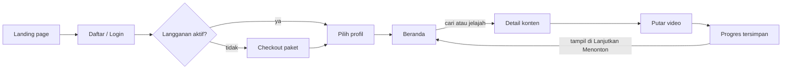
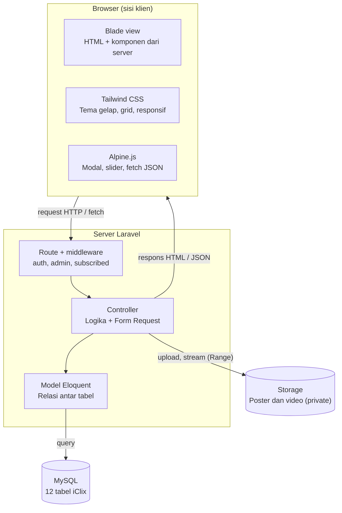

# PRD iClix — Platform Streaming Film

Terakhir diperbarui: 6 November 2026

## 1. Ringkasan Produk

iClix adalah website streaming film dan serial bergaya Netflix: pengguna mendaftar, memilih paket langganan, lalu menonton konten dari katalog yang dikelola admin. Website dibangun dengan **Laravel** (backend + Blade), **Alpine.js** (interaksi di sisi klien) dan **Tailwind CSS** (tampilan).

| Item | Keterangan |
| --- | --- |
| Nama produk | iClix |
| Jenis | Web app streaming video (responsif: desktop, tablet, ponsel) |
| Pengguna | Tamu, Member, Admin |
| Tech stack | Laravel 11/12, Blade, Alpine.js 3, Tailwind CSS 3/4, MySQL |
| Konteks | Tugas/proyek kuliah, dikerjakan dalam ±8 minggu |

## 2. Latar Belakang & Tujuan

Proyek ini melatih pembuatan aplikasi web lengkap: autentikasi, CRUD, relasi database, upload file, pemutaran video dan UI interaktif. Netflix dipilih sebagai acuan karena alurnya jelas dan fiturnya mudah diukur.

Tujuan proyek:

1. Pengguna bisa daftar, login, memilih paket dan menonton video sampai selesai.
2. Admin bisa mengelola film, serial, episode, genre, paket dan pengguna dari satu dashboard.
3. Tampilan terasa seperti Netflix: tema gelap, banner hero, baris konten yang bisa digeser, modal detail.
4. Kode rapi mengikuti konvensi Laravel (MVC, migration, seeder, form request, policy).

## 3. Target Pengguna & Peran

iClix punya tiga peran dengan hak akses berbeda.

| Peran | Siapa | Bisa melakukan |
| --- | --- | --- |
| Tamu (guest) | Pengunjung yang belum login | Melihat landing page, daftar paket, FAQ; daftar dan login |
| Member | Pengguna terdaftar | Pilih paket, kelola profil, jelajah katalog, cari, tonton, simpan ke Daftar Saya, lanjut menonton |
| Admin | Pengelola iClix | Semua fitur dashboard: CRUD konten, genre, paket, pengguna; lihat statistik |

**Persona utama — Raka, 21 tahun, mahasiswa.** Menonton di laptop dan ponsel saat malam. Ingin cepat menemukan film sesuai genre, melanjutkan tontonan yang terhenti, dan tidak bingung saat memilih paket.

**Persona admin — Sinta, 25 tahun, pengelola konten.** Mengunggah film baru tiap minggu. Butuh form yang sederhana, upload poster/video yang jelas progresnya, dan daftar konten yang bisa dicari.

## 4. Ruang Lingkup

Versi 1 fokus pada alur inti menonton dan pengelolaan konten; pembayaran asli dan aplikasi mobile tidak termasuk.

**Termasuk (in scope)**

- Autentikasi: daftar, login, logout, lupa password (Laravel Breeze)
- Pilihan paket langganan dengan pembayaran simulasi (tanpa payment gateway asli)
- Multi-profil per akun (maks. 4 profil, termasuk profil anak)
- Katalog film dan serial (musim + episode), genre, pencarian, filter
- Pemutar video HTML5 dengan simpan progres tonton (Lanjutkan Menonton)
- Daftar Saya (watchlist) dan rating suka/tidak suka
- Dashboard admin: CRUD konten, genre, paket, pengguna, statistik sederhana

**Tidak termasuk (out of scope)**

- Payment gateway asli (Midtrans/Xendit) — bisa jadi pengembangan lanjutan
- Streaming adaptif HLS/DASH, DRM, dan download offline
- Aplikasi Android/iOS dan Smart TV
- Rekomendasi berbasis machine learning (cukup berdasarkan genre)

## 5. Kebutuhan Fungsional

Ada 30 kebutuhan; semua yang berprioritas **Wajib** harus selesai agar tugas bisa didemokan. Prioritas: Wajib = harus ada, Penting = sangat dianjurkan, Opsional = nilai tambah.

| ID | Modul | Kebutuhan | Prioritas |
| --- | --- | --- | --- |
| F-01 | Autentikasi | Tamu bisa daftar dengan nama, email, password | Wajib |
| F-02 | Autentikasi | Login, logout, "ingat saya" | Wajib |
| F-03 | Autentikasi | Lupa password via email (reset link) | Penting |
| F-04 | Autentikasi | Middleware membedakan member dan admin | Wajib |
| F-05 | Langganan | Halaman pilihan paket (Basic, Standar, Premium) dengan harga, kualitas, jumlah layar | Wajib |
| F-06 | Langganan | Checkout simulasi: pilih paket → konfirmasi → langganan aktif 30 hari | Wajib |
| F-07 | Langganan | Member tanpa langganan aktif diarahkan ke halaman paket saat mau menonton | Wajib |
| F-08 | Langganan | Riwayat transaksi dan tanggal berakhir langganan di halaman akun | Penting |
| F-09 | Profil | Pilih profil setelah login ("Siapa yang menonton?") | Penting |
| F-10 | Profil | Tambah, ubah, hapus profil (maks. 4), pilih avatar | Penting |
| F-11 | Profil | Profil anak hanya melihat konten rating usia SU/7+ | Opsional |
| F-12 | Beranda | Hero slider konten unggulan (maks. 5): tanggal rilis, genre, judul besar, tagline, tombol Tonton dan Trailer, thumbnail pemilih, tombol suka/simpan/info (lihat bagian 11) | Wajib |
| F-13 | Beranda | Baris konten per kategori (Trending, Baru, per genre) yang bisa digeser horizontal | Wajib |
| F-14 | Beranda | Baris "Lanjutkan Menonton" dengan progress bar | Penting |
| F-15 | Katalog | Halaman Film dan Serial terpisah, filter genre dan tahun | Wajib |
| F-16 | Detail | Modal/halaman detail: sinopsis, tahun, durasi, rating usia, genre, pemeran, trailer | Wajib |
| F-17 | Detail | Serial menampilkan pilihan musim dan daftar episode | Wajib |
| F-18 | Detail | Rekomendasi "Mirip dengan ini" berdasarkan genre | Opsional |
| F-19 | Pencarian | Cari judul secara live (debounce 300 ms) dengan hasil grid | Wajib |
| F-20 | Pemutar | Putar video HTML5: play/pause, volume, fullscreen, seek | Wajib |
| F-21 | Pemutar | Simpan progres tiap 10 detik dan lanjutkan dari posisi terakhir | Penting |
| F-22 | Pemutar | Tombol "Episode berikutnya" untuk serial | Opsional |
| F-23 | Daftar Saya | Tambah/hapus konten ke Daftar Saya tanpa reload halaman | Wajib |
| F-24 | Rating | Suka/tidak suka per konten | Opsional |
| F-25 | Admin | Dashboard ringkasan: jumlah member, langganan aktif, konten, top 5 ditonton | Penting |
| F-26 | Admin | CRUD film: judul, slug, sinopsis, tahun, tanggal rilis, tagline, durasi, rating usia, poster, backdrop, video, trailer | Wajib |
| F-27 | Admin | CRUD serial, musim, dan episode | Wajib |
| F-28 | Admin | CRUD genre dan paket langganan | Wajib |
| F-29 | Admin | Kelola pengguna: lihat, cari, nonaktifkan akun | Penting |
| F-30 | Admin | Tandai konten sebagai unggulan (tampil di banner hero) | Penting |

## 6. User Flow

Member tanpa langganan aktif selalu diarahkan ke checkout; setelah menonton, progres tersimpan dan konten muncul lagi di beranda.



Admin punya alur terpisah: login → dashboard `/admin` → kelola konten, genre, paket dan pengguna.

## 7. Kebutuhan Non-Fungsional

| Aspek | Target |
| --- | --- |
| Performa | Halaman beranda tampil < 3 detik di koneksi 10 Mbps; gambar pakai `loading="lazy"` dan format WebP |
| Responsif | Nyaman dipakai di lebar 360 px (ponsel) sampai 1920 px (desktop) |
| Keamanan | Password di-hash (bcrypt), CSRF token di semua form, validasi via Form Request, akses admin lewat middleware/policy |
| Keamanan video | File video di `storage/app/private`, dialirkan lewat route yang mengecek login + langganan aktif (bukan URL publik) |
| Upload | Poster/backdrop maks. 2 MB (jpg, png, webp); video maks. 500 MB (mp4) |
| Aksesibilitas | Kontras teks cukup di tema gelap, tombol bisa dipakai dengan keyboard, `alt` di semua poster |
| Kompatibilitas | Chrome, Firefox, Edge, Safari versi terbaru |
| Kualitas kode | Konvensi PSR-12, nama route berurutan (`admin.movies.index`), tidak ada query N+1 (pakai eager loading) |

## 8. Arsitektur & Tech Stack

Halaman dirender server lewat Blade; Alpine.js menangani interaksi kecil dan memanggil endpoint JSON (Daftar Saya, progres tonton, pencarian) tanpa reload.



| Komponen | Pilihan | Fungsi |
| --- | --- | --- |
| Framework | Laravel 11/12, PHP 8.2+ | Routing, MVC, Eloquent, migration, validasi |
| Starter auth | Laravel Breeze (Blade stack) | Login, daftar, reset password; sudah membawa Tailwind + Alpine |
| Styling | Tailwind CSS via Vite | Utility class, tema gelap, responsif |
| Interaksi | Alpine.js 3 (+ plugin `@alpinejs/intersect` opsional) | Modal, slider baris, dropdown profil, live search, toast |
| Database | MySQL 8 / MariaDB | Data pengguna, konten, langganan, riwayat |
| File | Laravel Storage (`public` untuk gambar, `private` untuk video) | Upload poster, backdrop, video |
| Pemutar | Tag `<video>` HTML5 + kontrol Alpine | Putar, seek, kirim progres tiap 10 detik |
| Alat bantu | Git + GitHub, Laravel Pint, Laragon/XAMPP | Versi kode, format kode, server lokal |

## 9. Rancangan Database

Film dan serial disimpan di satu tabel `contents` dengan kolom `type`, supaya beranda, pencarian dan Daftar Saya cukup membaca satu tabel. Total 12 tabel (di luar tabel bawaan Laravel seperti `sessions`, `password_reset_tokens`).

| Tabel | Kolom utama | Relasi |
| --- | --- | --- |
| `users` | id, name, email, password, role (admin/member), is_active | hasMany profiles, subscriptions |
| `profiles` | id, user_id, name, avatar, is_kids | belongsTo user; hasMany watch_histories, watchlists, ratings |
| `plans` | id, name, price, quality (480p/1080p/4K), max_screens, duration_days | hasMany subscriptions |
| `subscriptions` | id, user_id, plan_id, starts_at, ends_at, status, amount, invoice_code | belongsTo user, plan |
| `genres` | id, name, slug | belongsToMany contents |
| `contents` | id, type (movie/series), title, slug, synopsis, release_year, release_date, tagline, duration_min, age_rating, poster, backdrop, trailer_url, video_path, is_featured, views | belongsToMany genres; hasMany seasons |
| `content_genre` | content_id, genre_id | pivot |
| `seasons` | id, content_id, season_number, title | belongsTo content; hasMany episodes |
| `episodes` | id, season_id, episode_number, title, synopsis, duration_min, thumbnail, video_path | belongsTo season |
| `watch_histories` | id, profile_id, content_id, episode_id (nullable), position_sec, duration_sec, updated_at | belongsTo profile, content, episode |
| `watchlists` | id, profile_id, content_id | belongsTo profile, content (unique pasangan) |
| `ratings` | id, profile_id, content_id, value (1 = suka, -1 = tidak suka) | belongsTo profile, content (unique pasangan) |

Seeder menyiapkan 1 admin, 3 paket, 10 genre dan minimal 20 konten contoh agar beranda langsung terisi saat demo.

## 10. Daftar Halaman & Rute

| Halaman | Method & URL | Akses |
| --- | --- | --- |
| Landing page | GET `/` | Tamu |
| Daftar / Login | GET·POST `/register`, `/login` | Tamu |
| Pilih paket | GET `/plans` | Member |
| Checkout simulasi | GET `/checkout/{plan}`, POST `/checkout/{plan}` | Member |
| Pilih profil | GET `/profiles`, POST `/profiles/{profile}/select` | Member |
| Kelola profil | resource `/profiles` | Member |
| Beranda (browse) | GET `/browse` | Member berlangganan |
| Film / Serial | GET `/movies`, `/series` | Member berlangganan |
| Detail konten | GET `/title/{content:slug}` | Member berlangganan |
| Pencarian | GET `/search?q=` | Member berlangganan |
| Daftar Saya | GET `/my-list`, POST/DELETE `/my-list/{content}` | Member berlangganan |
| Pemutar | GET `/watch/{content:slug}/{episode?}` | Member berlangganan |
| Stream video | GET `/stream/{content}/{episode?}` | Member berlangganan |
| Simpan progres | POST `/progress` (JSON) | Member berlangganan |
| Akun & langganan | GET `/account` | Member |
| Dashboard admin | GET `/admin` | Admin |
| Kelola konten | resource `/admin/contents`, `/admin/contents/{content}/seasons`, `/admin/seasons/{season}/episodes` | Admin |
| Kelola genre, paket, pengguna | resource `/admin/genres`, `/admin/plans`, `/admin/users` | Admin |

Middleware yang dipakai: `auth`, `admin` (cek role), `subscribed` (cek langganan aktif) dan `profile.selected` (cek profil dipilih di session).

## 11. Panduan Desain UI/UX

Tampilan memakai tema gelap dengan satu warna aksen, mengikuti pola Netflix tanpa menyalin logo atau aset mereka.

| Elemen | Ketentuan |
| --- | --- |
| Warna dasar | Latar `#0B0B0F`, kartu `#16161D`, teks `#F5F5F5`, teks sekunder `#A1A1AA` |
| Warna aksen iClix | Ungu `#7C3AED` + magenta `#C026D3` untuk glow hero, mengikuti referensi hero (simpan di `@theme` sebagai `brand` dan `glow`) |
| Font | Poppins atau Urbanist (sans geometris seperti referensi); judul hero 72–96 px, judul lain 28–48 px, isi 14–16 px |
| Navigasi | Sidebar ikon vertikal di kiri (desktop/tablet) + search bar kaca di kanan atas; di ponsel menjadi bottom nav. Detail di subbagian Hero Section |
| Kartu poster | Rasio 2:3, hover membesar 1,05× dengan bayangan; info singkat muncul saat hover |
| Baris konten | Scroll horizontal dengan tombol panah kiri/kanan (Alpine `x-ref` + `scrollBy`) |
| Modal detail | Dibuka dengan Alpine `x-show` + `x-transition`, tutup dengan Esc atau klik luar |
| Skeleton loading | Kotak abu-abu `animate-pulse` saat gambar/hasil pencarian dimuat |
| Notifikasi | Toast kecil di pojok kanan bawah (mis. "Ditambahkan ke Daftar Saya") |

Komponen Blade yang disiapkan: `<x-sidebar>`, `<x-search-bar>`, `<x-hero-slider>`, `<x-content-row>`, `<x-poster-card>`, `<x-modal>`, `<x-toast>`, `<x-admin.sidebar>`.

Untuk isi video dan poster, gunakan konten berlisensi bebas (mis. film terbuka Blender seperti *Big Buck Bunny* atau *Sintel*) atau trailer YouTube yang di-embed, agar tidak melanggar hak cipta.

### Hero Section (mengikuti referensi desain)

Hero berupa kartu besar bertema navy–ungu: info film di kiri, foto karakter menempel di kanan, sidebar ikon di kiri dan search bar kaca di kanan atas. Nomor di wireframe merujuk ke tabel di bawahnya.

```text
┌──────┬───────────────────────────────────┬──────────────────────────────┐
│ ▪▪   │                                   │ (2) ( 🔍 Cari film...    ☰ ) │
│ ▪▪   │                                   │                              │
│      │ (3) 17 Mei      aksi, thriller    │                              │
│ (●)  │                                   │                              │
│ ( )  │ (4) JUDUL FILM                    │    FOTO KARAKTER / BACKDROP  │
│ ( )  │     Tagline atau subjudul (2019)  │    subjek di kanan,          │
│ ( )  │                                   │    gradasi gelap ke kiri     │
│ ( )  │ (5) [ ▶ Tonton ]  ( Trailer )     │                              │
│ ( )  │                                   │                              │
│      │ (6) [■] [□] [□] [□] [□]           │                              │
│ (1)  │     ━━━━─────────────────         │        (7)  (♥) (🔖) (i)     │
└──────┴───────────────────────────────────┴──────────────────────────────┘
```

| No | Elemen | Spesifikasi | Petunjuk Tailwind / Alpine |
| --- | --- | --- | --- |
| 1 | Sidebar ikon | Logo 4 kotak di atas, lalu 6 tombol bulat 48 px: Beranda, Film, Serial, Trending, Daftar Saya, Genre. Tombol aktif berlatar putih 15%, lainnya 5%; garis pemisah tipis di kanan | `w-24 flex flex-col items-center gap-4 border-r border-white/10`; tombol `size-12 rounded-full bg-white/5 hover:bg-white/15` |
| 2 | Search bar | Pill kaca di kanan atas, ikon cari di kiri, placeholder "Cari film...", tombol filter bulat di kanan | `rounded-full bg-white/10 backdrop-blur-md border border-white/10`; terhubung ke live search F-19 |
| 3 | Meta | Tanggal rilis dan genre, 16–18 px, putih 80%, jarak lebar di antaranya | `text-white/80 flex gap-12` |
| 4 | Judul + tagline | Judul kapital 72–96 px, tebal, tracking rapat, maks. 2 baris; tagline/subjudul + tahun 20–24 px di bawahnya | `text-6xl lg:text-8xl font-bold uppercase tracking-tight leading-none` |
| 5 | Tombol aksi | "Tonton sekarang": pill putih solid, teks hitam, ikon play. "Trailer": pill outline putih | `bg-white text-black rounded-full px-6 py-3`; `border border-white/60 rounded-full` |
| 6 | Thumbnail + progres | 5 thumbnail ±80×80 px sudut membulat; yang aktif terang, lainnya redup 60%; garis progres di bawah terisi selama 8 detik | `x-for`; `:class="active === i ? 'ring-2 ring-white' : 'opacity-60'"` |
| 7 | Tombol cepat | 3 tombol bulat 48 px di kanan bawah: suka (F-24), simpan ke Daftar Saya (F-23), info detail yang membuka modal (F-16). Referensi memakai ikon "+"; iClix memakai "i" agar tidak dobel dengan simpan | `rounded-full border border-white/30 bg-black/30 backdrop-blur` |
| – | Latar kartu | Backdrop 16:9 dengan subjek di kanan; overlay gradasi navy dari kiri; glow magenta samar di kiri atas; sudut kartu membulat; tinggi ±85% layar | `rounded-3xl min-h-[85vh] overflow-hidden`; overlay `bg-gradient-to-r from-[#141632] via-[#141632]/80 to-transparent`; glow `bg-fuchsia-600/30 blur-3xl` |

**Perilaku (Alpine.js)**

- Data hero diambil dari `contents` dengan `is_featured = true`, maks. 5, dikirim lewat `x-data="heroSlider(@js($featured))"`.
- Slide berganti otomatis tiap 8 detik dan berhenti saat kursor di atas hero (`@mouseenter` / `@mouseleave`).
- Klik thumbnail atau tombol panah kiri/kanan keyboard mengganti slide; backdrop dan teks berganti dengan fade 500–700 ms (`x-transition.opacity`).
- "Tonton sekarang" membuka `/watch/{slug}`; member tanpa langganan aktif diarahkan ke `/plans` (F-07).
- "Trailer" membuka modal berisi iframe YouTube; iframe dikosongkan saat modal ditutup agar suara berhenti.
- Suka dan Simpan mengirim `fetch` POST dengan token CSRF, ikon berubah terisi dan muncul toast, tanpa reload.

**Responsif**

| Lebar layar | Perubahan |
| --- | --- |
| ≥ 1024 px | Seperti referensi |
| 768–1023 px | Sidebar tetap, judul 56 px, thumbnail 4 buah |
| < 768 px | Sidebar menjadi bottom nav 5 ikon; search jadi ikon di bar atas; backdrop penuh dengan gradasi dari bawah; judul 36–40 px; thumbnail scroll horizontal; tombol cepat pindah ke bawah tombol aksi |

Admin wajib mengunggah backdrop minimal 1920×1080 px dengan subjek di sisi kanan. Kolom `release_date` dan `tagline` sudah ditambahkan ke tabel `contents` untuk elemen 3 dan 4. Pakai gambar berlisensi bebas, bukan foto aktor atau still film komersial seperti di referensi.

## 12. Timeline & Milestone

Asumsi 8 minggu; geser jika deadline berbeda. Dashboard admin dikerjakan lebih dulu supaya data konten sudah ada saat membangun halaman member.

| Minggu | Tahap | Pekerjaan |
| --- | --- | --- |
| 1 | Persiapan proyek | Breeze, Tailwind, Alpine, migration, seeder |
| 2–3 | Dashboard admin | CRUD konten, musim, episode, genre, upload |
| 4 | Langganan dan profil | Paket, checkout simulasi, multi-profil |
| 5–6 | Halaman member | Beranda (hero slider), katalog, detail, cari, Daftar Saya |
| 7 | Pemutar video | Stream + Range, simpan progres, lanjutkan |
| 8 | Uji coba dan demo | Perbaikan bug, README, latihan presentasi |

Milestone: di akhir minggu ke-4, admin sudah bisa mengisi konten dan member sudah bisa berlangganan.

## 13. Kriteria Penerimaan, Risiko & Asumsi

**Kriteria penerimaan (definition of done)**

- [ ] Semua 17 kebutuhan berprioritas Wajib berjalan tanpa error
- [ ] Alur demo lengkap: daftar → pilih paket → pilih profil → cari film → tonton → lanjutkan dari posisi terakhir
- [ ] Admin bisa menambah film baru dan film itu langsung muncul di beranda member
- [ ] Member tanpa langganan aktif tidak bisa membuka `/watch` maupun `/stream`
- [ ] Tampilan rapi di ponsel 360 px dan desktop 1920 px
- [ ] `php artisan migrate --seed` di komputer baru langsung menghasilkan data demo

**Risiko & mitigasi**

| Risiko | Dampak | Mitigasi |
| --- | --- | --- |
| File video besar memperlambat upload dan repositori | Upload gagal, repo Git membengkak | Batasi 500 MB, simpan di `storage` dan masukkan ke `.gitignore`; pakai video contoh berdurasi pendek |
| Video bisa diakses langsung lewat URL | Bypass langganan | Stream lewat controller dengan cek middleware, bukan folder `public` |
| Seek video tidak jalan di server lokal | Pemutar tidak bisa digeser | Dukung header `Range` (response `206 Partial Content`) di controller stream |
| Waktu pengerjaan mepet | Fitur inti belum selesai | Kerjakan prioritas Wajib dulu; Opsional hanya jika ada sisa waktu |
| Hak cipta poster/video | Masalah saat dipublikasikan | Pakai konten berlisensi bebas atau trailer resmi via embed |

**Asumsi**

- Pembayaran hanya simulasi; tombol "Bayar" langsung mengaktifkan langganan.
- Website dijalankan lokal (Laragon/XAMPP/`php artisan serve`) atau di hosting dengan PHP 8.2+.
- Satu akun boleh dipakai beberapa profil, tanpa pembatasan jumlah layar yang benar-benar aktif.
- Deadline tugas belum diketahui; timeline di bagian 12 memakai asumsi 8 minggu.
